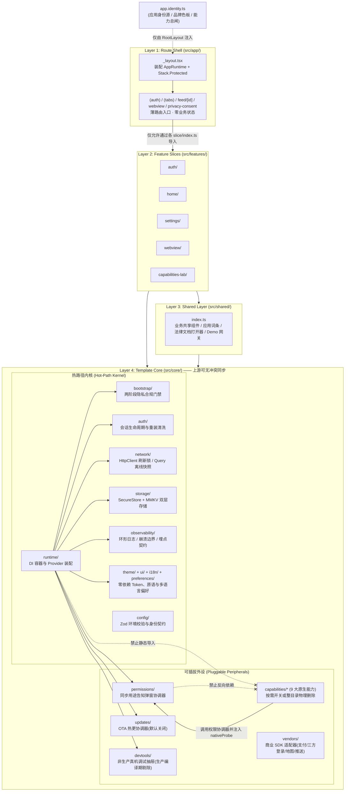
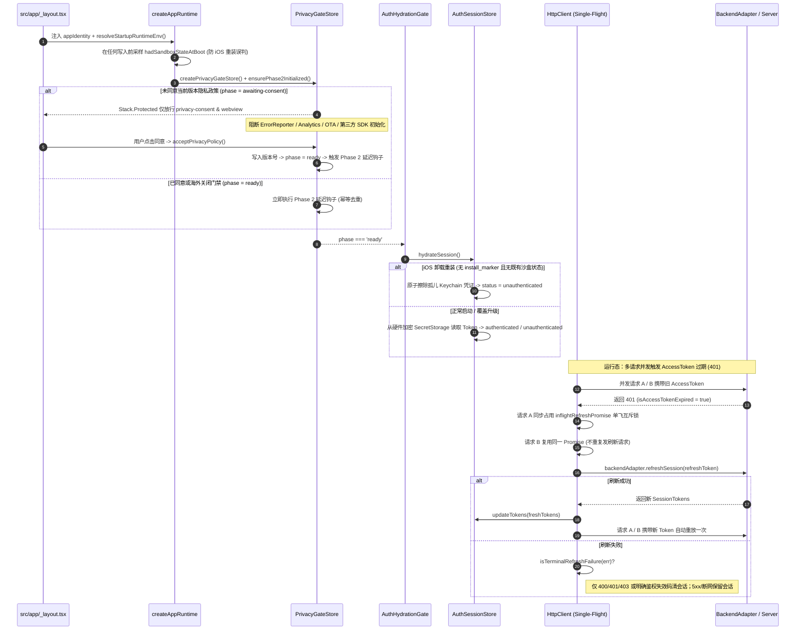
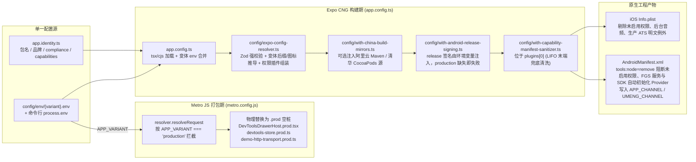

# 技术架构全景与模块职责手册 (`ARCHITECTURE.md`)

> 本文档是 **Enterprise React Native App Foundation** 的**结构拓扑单一事实源（Architecture Map）**，面向三类读者：
> 1. **架构与项目负责人**：5 分钟掌控全项目分层、启动主链路、构建期裁剪与安全红线；
> 2. **业务开发者**：快速定位“每个模块做什么、入口在哪、改什么不会破坏底座升级”；
> 3. **AI 编程助手**：作为精确的目录索引、依赖边界与模块不变量上下文。
>
> - 领域术语表见 [`CONTEXT.md`](../CONTEXT.md)
> - 关键技术选型理由见 [`docs/adr/`](./adr/)（ADR-0001 ~ ADR-0007，其中 0006、0007 仍为 Proposed）
> - 日常上手与场景操作手册见 [`README.md`](../README.md)

---

## 1. 四条不可妥协的架构红线

1. **单向四层隔离（ESLint 强制拦截）**：`src/app` → `src/features` → `src/shared` → `src/core`。严禁任何反向依赖，严禁跨 Feature Slice 深层引用，严禁 `src/core` 直接导入根目录 `app.identity.ts`（见 [`eslint.config.js`](../eslint.config.js) 与 [ADR-0002](./adr/0002-directory-isolated-template-sync.md)）。
2. **两阶段隐私门禁（合规红线）**：`requirePrivacyConsent = true` 时，用户点击同意前**严禁**初始化任何读取设备标识/上报遥测的第三方 SDK；Android 端额外在构建期通过 `tools:node="remove"` 阻断第三方 `ContentProvider` 抢跑（见 [ADR-0004](./adr/0004-two-phase-privacy-gate-bootstrap.md)）。
3. **能力可物理删除 + 声明与实现同源**：`src/core/runtime` 与 `src/core/permissions` 严禁静态导入任何 `src/core/capabilities/*` 子模块；关闭某个能力布尔值即在构建期剔除其 `Info.plist` / `AndroidManifest.xml` 权限声明（见 [ADR-0005](./adr/0005-batteries-included-capabilities-with-manifest-gating.md)）。
4. **严禁嗅探 `process.env.NODE_ENV` 分支**：`src/` 下禁止读取 `process.env.NODE_ENV`；测试替身通过 `AppRuntimeOverrides` 显式注入，生产调试代码剥离由 `metro.config.js` 按 `APP_VARIANT=production` 物理替换空桩。

---

## 2. 架构设计全景图

### 图 1：四层单向依赖与物理隔离拓扑图

> **关键边界**：`src/features/*` 之间**严禁互相引用**（含相对路径逃逸 `../../*`）；跨切片复用必须下沉至 `src/shared/`，跨产品复用才进入 `src/core/`。

---

### 图 2：冷启动、隐私门禁、鉴权水合与网络并发刷新锁时序图

---

### 图 3：构建期配置驱动、权限合规裁剪与生产物理剔除流水线

---

## 3. 全模块职责矩阵（Module Inventory）

### A. Template Core — 热路径内核（`src/core/` 核心基础设施）

| 模块路径 | 核心职责（做什么） | 入口文件 | 边界不变量 / 修改注意事项 |
| :--- | :--- | :--- | :--- |
| `src/core/runtime/` | 全局依赖注入容器与根 Provider 树装配（组装存储、鉴权、网络、隐私、观测、主题、键盘控制、轻提示、国际化、权限、OTA、DevTools），对外暴露 `useAppRuntime`、`useToast` 与各 Store Hook | [`app-runtime.ts`](../src/core/runtime/app-runtime.ts)（稳定入口） [`create-app-runtime.ts`](../src/core/runtime/create-app-runtime.ts)（容器装配） [`AppRuntimeProvider.tsx`](../src/core/runtime/AppRuntimeProvider.tsx)（根 Provider） [`runtime-hooks.ts`](../src/core/runtime/runtime-hooks.ts)、[`runtime-types.ts`](../src/core/runtime/runtime-types.ts) | 严禁静态导入 `src/core/capabilities/*`；`hadSandboxStateAtBoot` 必须在任何启动写入之前采样 |
| `src/core/config/` | 定义 `AppIdentity`、`RuntimePublicEnv` 类型契约，提供 Zod 强校验环境解析器与 URL 安全校验 | [`types.ts`](../src/core/config/types.ts) [`env-schema.ts`](../src/core/config/env-schema.ts) | 生产变体强制 `https://`；拒绝静默回退默认值，漏配必须启动即报错 |
| `src/core/bootstrap/` | 两阶段隐私合规门禁状态机与同意页视图组件：未同意前阻断二阶段 SDK，支持协议升版重签与撤回同意 | [`privacy-gate-store.ts`](../src/core/bootstrap/privacy-gate-store.ts) [`PrivacyGateView.tsx`](../src/core/bootstrap/PrivacyGateView.tsx) | 所有读取设备 ID / 上报遥测的 SDK 必须注册为 `DeferredSdkInitializer`，禁止模块加载期直接 init |
| `src/core/auth/` | 管理 `hydrating → authenticated / unauthenticated` 状态机，封装硬件密钥库 Token 读写、iOS 卸载重装孤儿 Keychain 清洗、登出广播 | [`auth-session-store.ts`](../src/core/auth/auth-session-store.ts) [`AuthHydrationGate.tsx`](../src/core/auth/AuthHydrationGate.tsx) | 敏感凭证严禁写入 MMKV；会话清空会通过 `onSessionCleared` 联动清空 Query 缓存与离线快照 |
| `src/core/network/` | Axios 封装 + 单飞 Token 刷新互斥锁、可插拔 `BackendAdapter` 协议适配、终端失效判定策略、TanStack Query 客户端、按需离线快照持久化、断网横幅 | [`http-client.ts`](../src/core/network/http-client.ts) [`types.ts`](../src/core/network/types.ts) [`refresh-failure-policy.ts`](../src/core/network/refresh-failure-policy.ts) [`query-persistence.ts`](../src/core/network/query-persistence.ts) | `BackendAdapter` 只适配协议信封与刷新逻辑，不放具体业务 API；离线持久化仅限 `meta.persistOffline: true` 的非敏感公开数据 |
| `src/core/storage/` | 双层本地存储抽象与实现：敏感凭证走 `expo-secure-store`（绑定 `THIS_DEVICE_ONLY` 防 iCloud 备份外泄），常规 KV 走 `react-native-mmkv`；附测试用内存驱动 | [`native-storage.ts`](../src/core/storage/native-storage.ts) [`types.ts`](../src/core/storage/types.ts) [`memory-storage.ts`](../src/core/storage/memory-storage.ts) | 生产路径 MMKV 初始化失败必须直接抛错，严禁静默降级内存存储导致隐私同意记录丢失 |
| `src/core/observability/` | 固定容量环形日志缓冲（100 条）、React 渲染错误边界、全局 JS 异常与未捕获 Promise 拒绝捕获、可插拔崩溃上报与埋点契约 | [`observability.ts`](../src/core/observability/observability.ts) [`AppErrorBoundary.tsx`](../src/core/observability/AppErrorBoundary.tsx) [`performance-marks.ts`](../src/core/observability/performance-marks.ts)（启动与路由耗时标记，仅内存，开发抽屉可见） | `errorReporter` 与 `analytics` 仅在 Privacy Gate 进入 `ready` 后由二阶段钩子激活 |
| `src/core/theme/` & `src/core/ui/` | 基于品牌种子推导亮/暗双模式语义 Design Token，提供零第三方样式库依赖的 `StyleSheet` 原语组件（`Screen` / `KeyboardStickyFooter` / `Box` / `Stack` / `AppText` / `Button` / `TextField` / `Switch` / `Select` / `ConfirmDialog` / `ToastHost` / `BottomSheetModal` / `AppImage` / `Skeleton` / `EmptyState`），并集成 `react-native-keyboard-controller` 处理双端软键盘动画 | [`theme-context.tsx`](../src/core/theme/theme-context.tsx) [`tokens.ts`](../src/core/theme/tokens.ts) [`ui/index.ts`](../src/core/ui/index.ts) | 遵循 [ADR-0003](./adr/0003-zero-dependency-themed-stylesheet.md)，业务 UI 禁止硬编码色值，统一消费语义 Token |
| `src/core/i18n/` & `src/core/preferences/` | `i18next` 实例创建、内核基础词条、设备语言探测（隐私未同意前不读取系统 Locale）；持久化用户主题模式与语言偏好 | [`i18n.ts`](../src/core/i18n/i18n.ts) [`preferences-store.ts`](../src/core/preferences/preferences-store.ts) | 业务自定义词条放 `src/shared/i18n/` 并通过 `createAppRuntime({ translations })` 合并，不直接改内核词条 |

### B. Template Core — 可插拔外设与 9 大原生能力（`src/core/`）

| 模块路径 | 核心职责（做什么） | 入口文件 | 边界不变量 / 修改注意事项 |
| :--- | :--- | :--- | :--- |
| `src/core/permissions/` | 统一管理敏感权限申请流程：串行排队“用途告知（Permission Rationale）”弹窗，并在 `denied_blocked` 时引导跳转系统设置 | [`permission-coordinator.ts`](../src/core/permissions/permission-coordinator.ts) [`PermissionPromptHost.tsx`](../src/core/permissions/PermissionPromptHost.tsx) | 严禁反向导入 `src/core/capabilities/*`，具体权限探针由各能力模块以 `nativeProbe` 回调传入 |
| `src/core/capabilities/` | 9 大免第三方商业密钥的预置原生能力模块：`camera`（扫码/拍照）、`media`（相册选图/保存）、`files`（文档选择/系统分享）、`webview`（安全混合容器 + 域名白名单 + 防 iframe 劫持 JSBridge）、`biometrics`（面容/指纹核身）、`location`（前台定位）、`notifications`（本地/推送通知）、`audio-video`（音视频播放录制）、`device-feedback`（震动/剪贴板/设备信息） | 各子目录 `index.ts(x)` 安全桥协议见 [`webview/bridge.ts`](../src/core/capabilities/webview/bridge.ts) | 每个子目录自包含且可物理删除；关闭 `app.identity.ts` 对应布尔开关即在构建期剔除原生权限；WebView 桥仅注入顶层 `window === window.top` 并校验 128-bit 一次性 nonce |
| `src/core/vendors/` | 商业第三方 SDK 适配器契约（社交登录、微信/支付宝/IAP 支付、外部地图导航、厂商推送）及 `useCommercialVendorAdapters` Hook | [`vendors/index.ts`](../src/core/vendors/index.ts) | 非生产环境自动回退免密钥 Mock 实现；**生产环境未显式注入真实实现时立即抛出 `VendorAdapterNotConfiguredError`**，严禁静默返回假成功 |
| `src/core/updates/` | OTA 热更新协调器与二阶段延迟初始化钩子 | [`ota-coordinator.ts`](../src/core/updates/ota-coordinator.ts) | 默认关闭；仅在显式开启并传入 `OtaUpdateDriver` 后于隐私门禁放行后检查更新 |
| `src/core/version-policy/` | 最低版本强制升级与远程 kill-switch 的客户端契约：适配器接口、策略 Store、阻断页。默认没有适配器即整体关闭，失败一律放行，请求默认不带标识符 | [`version-policy.ts`](../src/core/version-policy/version-policy.ts) [`ForceUpdateGate.tsx`](../src/core/version-policy/ForceUpdateGate.tsx) | 服务端接口由各应用提供；标识符只在隐私同意之后且应用显式提供来源时才会附带 |
| `src/core/devtools/` | 非生产环境真机悬浮调试抽屉（查看环境/渠道、动态切换 API BaseURL、查看环形日志、重置隐私/缓存、模拟断网） | [`DevToolsDrawerHost.tsx`](../src/core/devtools/DevToolsDrawerHost.tsx) [`devtools-store.ts`](../src/core/devtools/devtools-store.ts) | 配套 `.prod.ts(x)` 空桩，由 `metro.config.js` 在 `APP_VARIANT=production` 时物理替换 |

### C. 应用装配与业务层（派生应用自有资产）

| 模块路径 | 核心职责（做什么） | 入口文件 | 边界不变量 / 修改注意事项 |
| :--- | :--- | :--- | :--- |
| `src/app/` | Expo Router 文件路由装配壳：根布局组装 `AppRuntime` 并以 `Stack.Protected` 声明三态守卫（未同意隐私 → 未登录 → 已登录），其余文件仅透传渲染 Feature 屏幕 | [`_layout.tsx`](../src/app/_layout.tsx) `(tabs)/_layout.tsx` | 保持薄壳：零业务状态、零复杂 UI，只通过 `@/features/<slice>` 顶层入口导入页面 |
| `src/features/` | 5 个预置业务/样板切片：`auth`（登录页）、`home`（信息流列表与详情页，含 `feed-api.ts` 示例）、`settings`（主题/语言/隐私撤回/登出设置）、`webview`（内置安全浏览器页）、`capabilities-lab`（9 大原生能力联调实验室） | 各切片 `index.ts` | 切片间完全隔离；运行 `pnpm init-app --clean-starter` 可剥离样板演示切片 |
| `src/shared/` | 本应用跨切片复用的业务组件（`FeedStatusBadge`、`VariantCapsuleBadge`）、应用级多语言词条、法律文档跳转 Hook、以及免后端演示网关（`demo-http-transport.ts`，生产打包物理替换为 `.prod.ts` 空桩） | [`shared/index.ts`](../src/shared/index.ts) | 只能依赖 `src/core`，严禁反向依赖 `src/features` 或 `src/app` |

### D. 构建期配置、工程脚本与验证防线

| 模块路径 | 核心职责（做什么） | 入口文件 | 边界不变量 / 修改注意事项 |
| :--- | :--- | :--- | :--- |
| 根身份与入口 | `app.identity.ts` 声明派生应用唯一身份、品牌色板种子、合规与能力总闸；`app.config.ts` 按 `APP_VARIANT` 加载 `config/env/<variant>.env` 并委托纯函数解析；`metro.config.js` 按变体隔离缓存并物理剔除生产调试桩 | [`app.identity.ts`](../app.identity.ts) [`app.config.ts`](../app.config.ts) [`metro.config.js`](../metro.config.js) | `app.identity.ts` 故意位于 `src/core` 之外，确保克隆改名与上游同步零冲突 |
| `config/` | `expo-config-resolver.ts`（纯函数推导三变体包名/图标/插件）、`with-capability-manifest-sanitizer.ts`（`plugins[0]` LIFO 兜底清洗权限、FGS、ATS、明文 HTTP、渠道 meta-data、第三方自动初始化 Provider）、`with-china-build-mirrors.ts`（可选阿里云 Maven / 清华 CocoaPods 源）、`with-android-release-signing.ts`（release 签名由 `ANDROID_KEYSTORE_*` 环境变量注入，production 缺失时打包失败，绝不回退 debug 密钥）、`env/*.env` | [`expo-config-resolver.ts`](../config/expo-config-resolver.ts) [`with-capability-manifest-sanitizer.ts`](../config/with-capability-manifest-sanitizer.ts) [`with-china-build-mirrors.ts`](../config/with-china-build-mirrors.ts) [`with-android-release-signing.ts`](../config/with-android-release-signing.ts) | `withCapabilityManifestSanitizer` 必须保持在 `plugins[0]`；镜像开关独立于隐私开关，需显式开启或由 `EXPO_USE_CHINA_MIRRORS` 控制；签名插件在 production 下找不到 Gradle 锚点必须抛错，不得静默回退 |
| `scripts/` & `fastlane/` | `init-app.ts`（克隆初始化与 `--clean-starter` 裁剪）、`distribute-internal.ts`（蒲公英上传与飞书/企微/钉钉群机器人通知）、`verify-variant-config.cjs`（多变体配置快照校验）、`Fastfile`（本地 Android 多渠道打包与 iOS 归档） | [`init-app.ts`](../scripts/init-app.ts) [`distribute-internal.ts`](../scripts/distribute-internal.ts) [`Fastfile`](../fastlane/Fastfile) | 核心纯逻辑拆分在 `scripts/lib/*-core.ts` 便于单测覆盖；iOS 签名变量的解析与校验在 `fastlane/lib/ios_signing.rb`，由 seam 测试直接执行 |
| `tests/` & `.maestro/` | 分层接缝测试：`seam-build-config/`（变体配置、清单权限裁剪、ESLint 边界红线、初始化脚本）与 `seam-runtime/`（隐私门禁、鉴权刷新锁、离线缓存、安全 WebView JSBridge、权限告知、厂商适配器、DevTools、键盘与 UI 表单/反馈组件）；`.maestro/flows/` 提供模块化 E2E 回归子流 | [`create-test-runtime.tsx`](../tests/helpers/create-test-runtime.tsx) [`smoke.yaml`](../.maestro/smoke.yaml) | 全量门禁命令：`pnpm verify`（`typecheck` + `lint` + `verify:maestro` + `jest --runInBand`） |

---

## 4. 高频改动定位速查（“我要改 X，去哪改？”）

| 改动目标 | 唯一正确落点 | 不要改哪里 |
| :--- | :--- | :--- |
| 改应用名、包名、Scheme、品牌主色、开关原生能力 | [`app.identity.ts`](../app.identity.ts) | 不要去改 `src/core/` 或手改 `ios/` / `android/` |
| 改各环境 API 地址或法律协议链接 | [`config/env/*.env`](../config/env/) | 不要在业务代码里硬编码域名 |
| 对接公司自定义后端信封格式 / 错误码 / 刷新接口 | 在 `src/shared/` 实现 `BackendAdapter` 并于 [`src/app/_layout.tsx`](../src/app/_layout.tsx) 传入 `createAppRuntime({ backendAdapter })` | 不要直接修改 `src/core/network/http-client.ts` |
| 接入微信登录、微信/支付宝支付、高德/百度地图、厂商推送 | 实现 `CommercialVendorAdapters` 并在 `createAppRuntime({ vendors })` 注入 | 不要修改 `src/core/vendors/index.ts` 的默认契约 |
| 接入友盟 / Sentry / 极光等第三方原生 SDK | 注册为 `createAppRuntime({ deferredInitializers })`，并在 `app.identity.ts` 的 `blockedAndroidAutoInitProviders` 中加入其自动初始化 Provider | 严禁在文件顶层或 `App` 挂载前直接初始化 |
| 新增一个业务模块（如订单 `orders`） | 新建 `src/features/orders/`（对外仅暴露 `index.ts`），并在 `src/app/` 新增薄路由文件 | 不要在 `src/app/` 写业务逻辑，不要跨 Feature 直接 import |

---

## 5. 相关文档索引

- **领域统一语言**：[`CONTEXT.md`](../CONTEXT.md)
- **架构决策记录（ADR）**：
  - [ADR-0001：Expo CNG 本地构建替代 Bare RN 与 EAS 锁定](./adr/0001-expo-cng-without-eas-lockin.md)
  - [ADR-0002：四层目录隔离替代私有 npm 包](./adr/0002-directory-isolated-template-sync.md)
  - [ADR-0003：零依赖主题化 StyleSheet 原语](./adr/0003-zero-dependency-themed-stylesheet.md)
  - [ADR-0004：两阶段隐私门禁启动模型](./adr/0004-two-phase-privacy-gate-bootstrap.md)
  - [ADR-0005：预置免密钥原生能力与构建期清单裁剪](./adr/0005-batteries-included-capabilities-with-manifest-gating.md)
- **场景化实操手册**：[`README.md`](../README.md)
